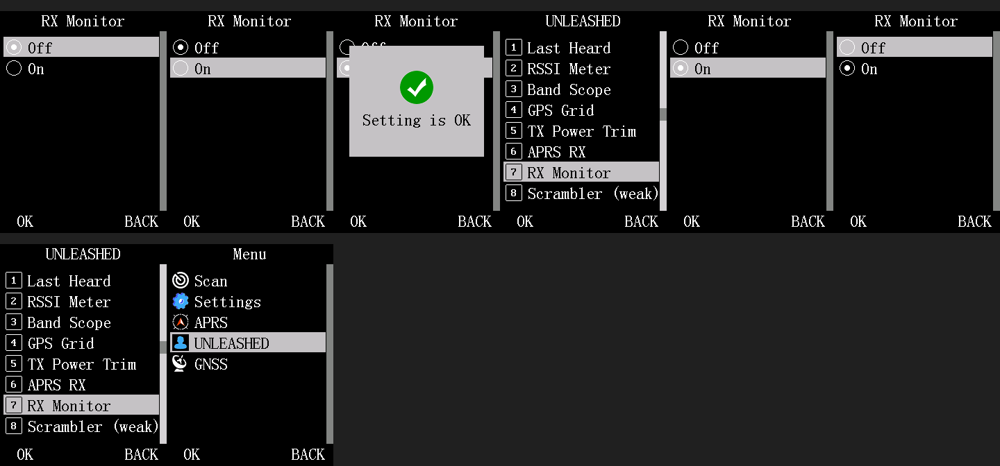
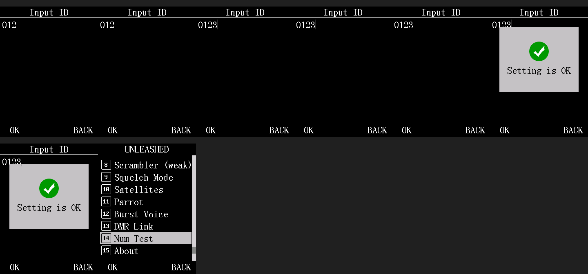
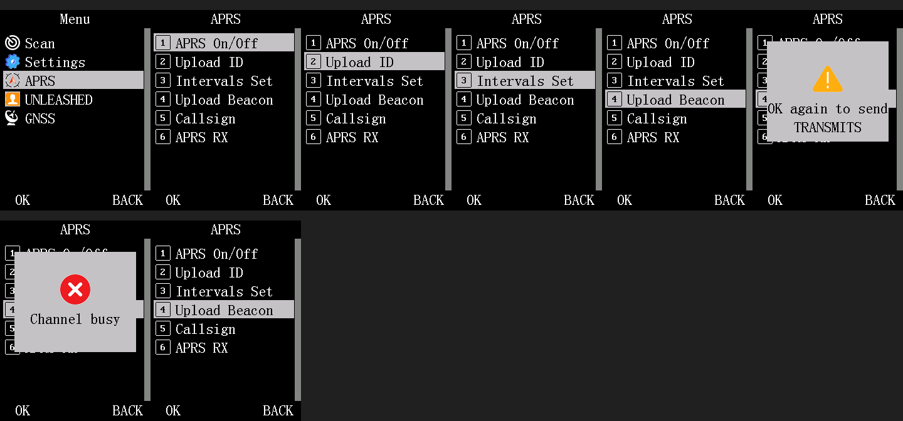

# Stock option level, stock numeric entry and stock popups for Kraken settings and actions (phase 0)

**Status (2026-11-02):** built, QEMU-verified (frames in `docs/img/`, checks in `tests/optrow_checks.py`), **not run on a radio**. Section 8 lists what
needs hardware. Nothing here touches the transmitter except the unchanged Upload Beacon send path behind its two-press gate.

Why: the KRAKEN screens were custom key-toggle pages (`#` On/Off, Up/Down cycle, `OK twice`). Stock menus have one idiom for a setting
(a radio-mark list) and one for an action (run it, show a popup, return to the menu). This document maps those idioms in the stock disassembly and
describes the shared mechanism that lets our rows use them. Follow-up conversions use the cookbook in section 6.

## 0. Verdicts and what shipped

| Question | Verdict | Shipped |
|---|---|---|
| Can a Kraken setting use the **genuine stock option level** (radio marks, selected option marked, Up/Down/OK/Back/scroll, cursor kept) with a RAM-backed value? | **YES.** The level is a plain stock sub-list (subtype 2) put into "radio mode" by two RAM cells (`0x00032ab6` = 2, `0x0003e91f` = the marked row). Stock enters it from an item-action case block that only fills cells and returns (APRS "Upload Type" case `0x0303d634` reads its value from the RAM struct `0x00040078`, so RAM-backed stock selectors exist). Three small hooks make it ours. | **The true stock level**, not a replica. Four splices (`0x0303ab42`, `0x030385f4`, `0x0304d81c`, `0x0303bb30`) and no blocking screen. First rows, scroll bar and soft-key bar are pixel-identical to stock Auto PowerOff in a QEMU frame compare. |
| Can a setting use the **stock numeric entry**? | **YES** with the same hooks plus one title hook. The stock text-entry screen (subtype 8, APRS "Input ID") is entered by a case block that fills cells and a text buffer, the digits and Back (= delete) are stock key handlers, OK reaches the category's commit handler. Range check and commit are ours. | Implemented in the same file (`struct krk_opt` with `labels = NULL`), unit-tested; validated on screen in QEMU with a temporary test row (frames), **first shipped customer: KRAKEN > Scrambler Key** (section 10). |
| Can a one-shot action use the **stock popup**? | **YES.** The stock popup is four plain calls (box `0x03019be8`, bitmap `0x03039034`, centered text `0x03018b5c`, delay `0x0300c4bc`); "Setting is OK" `0x0303a4dc` is a ready-made popup + history pop. | `krk_popup_draw` / `krk_popup` (same box, icons, fonts, positions) and a `KRK_SF_ONESHOT` runner flag. The shipped one-shot is Upload Beacon. The commit of an option row calls the real stock `0x0303a4dc`. |

Further conversions (2026-11-02, same mechanism, QEMU-verified, not run on a radio): **Squelch Mode** (3 options), **TX Power Trim** (8 options, `1/8`..`8/8`), **Parrot** (Off / On) as option levels, and **Parrot Play / Check / Clear** as one-shots (section 6.6).

Reference conversions: **RX Monitor** (KRAKEN > RX Monitor > Off / On, replaces the `#` key) and **Upload Beacon** (OK -> popup "OK again to send" -> OK -> send ->
result popup; no custom screen).

Files: `patches/kraken_ui/krk_optrow.c` (new), `krk.h`, `krk_core.c` (runner, row lookup, APRS hooks), `krk_stubs.S`, `kraken_ui.ld`,
`kraken_ui.patch.json` (4 splices), `krk_aprsrx.c` (RX Monitor row), `krk_aprs_menu.c` (Upload Beacon), `krk_ext.c` (slot 2), `tests/optrow_checks.py` (new),
`tests/kraken_ui_test.py`, `tests/mon_checks.py`.

## 1. The stock option level (research)

### 1.1 What it is

Menu > Settings > Radio Settings > Other Func > Auto PowerOff (QEMU, generic datachip):



(that frame shows our RX Monitor level, which is the same screen: title, radio mark column, highlighted row, scroll bar, OK / BACK bar.)

Cells and history at the stock level (gdb reads over the QEMU stub after the key script, 2026-11-02):

| What | Value at Auto PowerOff | At our RX Monitor level | Meaning |
|---|---|---|---|
| `0x0003e8f8` | 6 | 2 | item count |
| `0x0003e904` | `0x030b87c8` | label array in flash | string-pointer array the renderer reads |
| `0x18000a90` | 2 | 2 | screen subtype, 2 = generic list (`0x0303b720`) |
| `0x0003e5f8` | u16 6, items 0..5 | u16 2, items 0, 1 | index list the renderer reads (`string[index_list[row]]`) |
| `0x0003e5cc` / `0x0003e5d5` | cursor 0 / slot 1 | same | highlighted item / its 1-based position in the window |
| `0x00032ab6` (= `0x000320ac`+0xa0a) | **2** | **2** | row-icon mode: 0 text/bitmap, 1 numbered box (the sub-lists), **2 radio mark** |
| `0x0003e91f` | current value index | same | the row that carries the dot in radio mode |
| `0x000320ac` | `05 05 06 23` | `03 03 04 15` | `dialog_history_ui_state`: depth, depth, depth+1, **mode code** (7 per level: 0x0e list, 0x15 level 3, 0x1c, 0x23) |
| `0x0003e4e8` | `00 01 00 03 00` | `00 03 0a ...` | row chosen at each level ([1] = top row, [2] = sub-list row, ...) |

### 1.2 How the level is entered (item-action case block)

OK on a sub-list row pushes one history level (`0x0303699c`: cursor, slot, index list, depths, mode code `+7`) and runs the category's item-action case block
(`main_menu_render_and_field_edit_dispatch` `0x0303cdf0`, table `0x030aff18`); the block ends in the shared tail `0x0303d872` (`main_menu_screen_dispatch` `0x0303b6c4`), which draws the active cells.
The dispatcher sets `0x32ab6 = 1` first (`0x0303ceca`), the render dispatcher does the same (`0x0303d8d4`).

The APRS "Upload Type" block `0x0303d634` is the whole recipe (stock, annotated):

```
0303d634 lrw r3,0x3e9b4 ; ld.b r1,(r3,0x30) ; zext r1,r1,6,6      language bit
0303d63e lrw r2,0x30ba2a0                                          descriptor {u32 labels, u8 count, u8 subtype} per language
         ld.b r0,(r3+4) -> [0x3e8f8]   ld.w r2,(r2,r1<<3) -> [0x3e904]   ld.b (r3+1) -> [0x18000a90]
0303d662 build_sequential_index_list(count, 0x3e5f8, 0x3e5fa)      0x0304a118
0303d66c movi r2,2 ; st.b r2,(0x320ac + 0xa0a)                     0x32ab6 = 2: radio mode
0303d674 [0x40078] & 2 ? cursor = 1 : cursor = 0                   the CURRENT VALUE comes from a RAM struct (APRS runtime state)
         st.b cursor -> [0x3e5cc] ; st.b cursor -> [0x3e91f] ; slot [0x3e5d5] = cursor + 1
0303d6a2 br 0x0303d872                                              back to the shared tail: nothing blocks
```

The "Report Channel" block `0x0303d6a4` does the same with subtype 0x27 and an 8-row list whose cursor comes from the RAM channel struct (`0x3e1dc`+0x10). So **a stock
level over RAM state is ordinary stock behaviour**; the Settings > ... levels read the codeplug instead (below).

### 1.3 How it is drawn

* Subtype 2 -> `0x0303b720`: header (`0x03038528`), then `display_list_with_icons_renderer` `0x03041644`: for each visible row `display_draw_list_row` `0x03018cd8` (text, highlight bar on the
  slot row) and the row icon `menu_icon_draw_dispatch` `0x03039e64`.
* `0x03039e64` switches on `0x32ab6`: 1 = numbered box (`0x03039db4`); **2 = the radio circle bitmap `0x03082378` at x = 8, y = `0x03081f77[row]` and, when `0x3e91f == row`, the dot
  `0x030823c0`** (`0x03039f1a..0x03039f56`).
* The marks after a commit are redrawn by `menu_row_highlight_draw` `0x03041598` (circle for every row, circle + dot where `0x3e5cc == row`).
* Scroll bar, OK / BACK bar: drawn by the same dispatcher for any list.

### 1.4 The header text

`0x03038528` jumps through the 50-entry table `0x030afcdc` indexed by `mode code - 7`. Code 0x15 (level 3) -> `0x030385c4`: the category id (`0x3e63f`+2+row) indexes the table `0x030afda4`
(ten entries, each loads a per-language string by the sub-list item) and **category id >= 10 falls to `lrw r3,0x030b1458` (an empty string)** at `0x030385f4`; `0x03038ece` draws `r3` with
`display_draw_number_centered(1, 0xffff, 0, r3)` (`0x03018b5c`: y row 1, white on black, centered). Our title hook replaces those 6 bytes (section 2).

### 1.5 Keys and the commit

* **Up / Down**: stock list cursor handlers (cursor `0x3e5cc`, slot `0x3e5d5`, redraw through `0x03041644` / `0x03041598`).
* **OK**: the OK handler `0x0303a770` (event 0x1b in the key-event table at `0x030b02dc`; a second chain `0x0303a57c`, event 0x22 in the table at `0x030b0330`, has the same shape and is not what the OK key runs in QEMU; whether a long press or the MENU pin reaches it on hardware is open, section 8). It is a compare chain on the category id `0x3e63f`+2+`[0x3e4e9]`; categories 0..9 call their own handlers, e.g. APRS `0x0304d6c0`). For APRS the handler
  switches on the sub-list item (`0x3e664 + row`) and for the radio-mark items does: commit through the **field setter `0x0304b088(field id, value)`** (item 0: id 88; writes the settings
  block `0x3e9b4`+offset **and persists it in the codeplug** via `0x0300fa28`), `bsr 0x03041598` (marks), `bsr 0x0303a4dc` ("Setting is OK" popup, 1 s, then `history_queue_pop`).
  Settings-menu levels use the same setter with other field ids and read their current value through `0x0300f780`: **flash-backed by id, not hookable per row without adding a case per
  setting.** Category ids >= 10 reach the end of the chain, `0x0303ab42`: `set_mode(0x1c, 1)` (`0x03035ec4`), i.e. nothing useful. That is our commit hook site.
* **Back**: `history_queue_pop` (`0x03036c00`) and the render path of the category (`0x0303d8c8` -> table `0x030aff74` -> for category 10 our `krk_render_stub` -> `krk_category_entry`), so the list
  comes back with the cursor/slot restored from the history. No hook needed; verified.
* `0x0303a4dc` itself: box `0x03019be8`, bitmap, text, `0x0300c4bc(1000)`, `0x03036c00`. The text is the stock "Setting is OK" (language table `0x030b941c`).

### 1.6 Verdict A (option level)

Reusable with RAM-backed values, no replica needed. Our code supplies: the cells (like the APRS block), the header string, and the commit. Everything else (navigation, marks, scroll,
Back, popup, history, cursor) is stock. Evidence: frames `docs/img/optrow-rx-monitor.png` (open, Down, commit with the stock popup, list returns with the cursor on the row, reopen with the
dot on the new value, Up, Back cancels, Back to the menu) and `docs/img/optrow-aprs-option-level.png` (the same on an APRS-list row with 4 options); pixel compare in
`tests/optrow_checks.py`.

## 2. The mechanism

```
OK on a KRAKEN row (or an appended APRS row)   -- stock pushes a history level, calls our item-action (krk_item_ok / krk_aprs_item)
  row.opt != NULL  -> krk_opt_enter(opt): cells, index list, 0x32ab6 = 2, cursor / dot / slot from opt->get(); RETURN (stock tail draws the level)
  header           -> stock reaches 0x030385f4 (category >= 10)   --splice--> krk_title_stub -> krk_opt_title() -> 0x03038ece draws it
  Up/Down/scroll   -> stock
  Back             -> stock pop + render path (krk_category_entry / krk_aprs_render refills the list cells)
  OK               -> stock OK handler: category 10 ends at 0x0303ab42 --splice--> krk_opt_ok():
                        opt->set(cursor); 0x03041598 marks; 0x0303a4dc popup + pop; krk_category_entry() cells
                      category 9 handler 0x0304d6c0, items >= 8: 0x0304d81c --splice--> krk_aprs_ok_stub -> krk_aprs_opt_ok(item) -> same commit, krk_aprs_render()
```

### 2.1 Splices (all expected bytes asserted by the builder and again in `tests/optrow_checks.py`)

| Name | Address | Stock bytes | New | Why / registers |
|---|---|---|---|---|
| `opt_ok_hook` | `0x0303ab42` | `1c30 0131 ffe3bfd9` (`movi r0,28; movi r1,1; bsr 0x03035ec4`) | `bsr krk_opt_ok` + 2 x nop16 | Inside `0x0303a770` whose prologue pushed r4/r15 and whose epilogue (`0x0303ab4a`) pops them; reached only for category ids the chain does not know (>= 10). C function, r4-r11 kept. Non-setting rows get the stock `set_mode(0x1c,1)` back. |
| `opt_title_hook` | `0x030385f4` | `6413 00e86c04` (`lrw r3,[0x30b1458]; br 0x03038ece`) | `bsr krk_title_stub` + nop16 | Stub: `bsr krk_opt_title; mov r3,r0; lrw r2,0x3038ece; jmp r2` (never returns; the frame's epilogue is at `0x03038ece`). |
| `aprs_opt_ok_hook` | `0x0304d81c` | `473b 1408` (`cmpnei r3,7; bt 0x0304d846`) | `bsr krk_aprs_ok_stub` | r3 = level-2 item. Item 7 returns into the stock block at `0x0304d820`; items >= 8 -> `krk_aprs_opt_ok(item)` then `jmp 0x0304d846` (epilogue `addi sp,8; pop r15`). |
| `opt_numtitle_hook` | `0x0303bb30` | `7c11 83d1 8308` (`lrw r3,[0x30ba280]; ldr.w r3,(r3,r12<<2)`) | `bsr krk_numtitle_stub` + nop16 | Header of the stock text-entry screen, see 3.4. The stub keeps r0-r2 (loaded just before for the draw call) and returns r3 = `krk_num_title()`; r12 is not used afterwards. |

`krk_item_ok` and `krk_aprs_item` (item-action, already ours) branch on `screen->opt`. The popups need no splice.

### 2.2 `struct krk_screen` and `struct krk_opt` (`krk.h`)

`struct krk_screen` gained two fields at the end (size 28): `const struct krk_opt *opt` (non-NULL = the row opens the stock level; `enter`/`tick` are ignored) and `u8 flags`
(`KRK_SF_ONESHOT`). Existing screens use designated initializers, so they are unchanged.

```c
struct krk_opt {
    const char *title;              /* header, <= 19 chars; NULL = the row label */
    const char *const *labels;      /* n ASCII labels in flash; NULL = NUMERIC entry */
    u8 n;                           /* list: 2..8 options.  numeric: 1..8 digits */
    int (*get)(void);               /* list: current index.  numeric: current value (read when the level opens) */
    void (*set)(int v);             /* OK: commit (RAM only, policy P4) */
    u32 min, max;                   /* numeric only, inclusive */
};
```

N <= 8 because the cursor math assumes the whole list is one window (`slot = cursor + 1`); stock lists with more rows scroll and would need the slot clamp of `0x0303d6d6`.

### 2.3 Cost

Main blob flash +1500 bytes (10512 -> 12012 of the 12288-byte `kraken_ui_code` claim: **276 bytes free**), main `.bss` +0, ui2 flash -112 (22972 -> 22860 of 36864), ui2 `.bss` -8
(7667 -> 7659; the old Upload Beacon armed/t0 pair is gone, 17 bytes free), decoder claim unchanged (order R, M made explicit in `kraken_ui2.ld`). No new SRAM; the option rows keep nothing but their
own state. Converting a screen to an option row deletes its drawing code, so each conversion frees flash.

## 3. Numeric entry

### 3.1 The stock screen (APRS Input ID)



Digital VFO, APRS > Upload ID. Stock case block `0x0303d5de`:

```
cells from the RAM descriptor 0x18000b78 (count 1, subtype 8 = text entry; 0x18000b04 = 8 is the maximum length)
[0x3e318 + 6] |= 0x40                                  edit flag
[0x320ac + 4] == 1 ? 0x030596b0()                      reset the edit state (length 0x3edf6, saved 0x3ed28 / 0x3ee72)
sprintf(0x3ee84, "%d", [0x40078 + 8])  ; [0x3ee8c] = 0  the current value (APRS upload ID, RAM) as text, at most 8 characters
[0x3edf6] = strlen ; [0x3ee72] = 12 * len + 5            length, cursor pixel column
br 0x0303d872
```

Keys: digits are appended by the stock key handler (`0x03037718` -> `0x030596d0` / `0x03059748`, limit `0x18000b04`), **Back deletes a digit** (an empty buffer: Back leaves the level),
OK reaches the category handler: for APRS `0x0304d6c0` item 1 parses `0x3ee84` (`v = v*10 + digit`), checks `v - 1 <= 0xFFFFFF - 802`; in range -> `0x0304ce50(v)` (writes block 4 offset
0x332 and RAM `0x40078`+8), `0x0303a4dc`; out of range -> the two-line dialog `0x0301aba8` with "Out of Range" and `0x0300c4bc(1500)` then `history_queue_pop`. The edit flag is cleared at the end.

Not generic: `menu_numeric_setting_commit_with_range_check` `0x03036d1c` is hard-wired to the FM radio frequency and the channel-number editors; the usable commit is the per-category one.

### 3.2 Verdict B (numeric entry)

Reusable with RAM-backed values by the same three ideas: (a) our item-action fills the text-entry cells and the buffer, (b) the commit is ours at the OK hook, (c) the header is ours.
Validated in QEMU with a temporary test row (value 0 shown as `0`, digits `1 2 3` typed -> `0123`, OK -> stock "Setting is OK" popup, list back with the cursor on the row; `2`
below min 3 -> "Out of Range" dialog 1.5 s then the list; Back deletes then leaves, edit flag cleared): `docs/img/optrow-numeric-entry.png`, `optrow-numeric-out-of-range.png`,
`optrow-numeric-back.png` (header "Num Test" after the title hook).

Limits: maximum length is the stock 8 digits (`0x18000b04`, left alone: it is shared state; a smaller field relies on the range check at OK, which shows "Out of Range"); no sign, no decimals;
the buffer is shown as the shortest decimal (value 0 = `0`, which the user deletes or types after).

### 3.3 Our implementation (`krk_optrow.c`)

`krk_opt_enter` with `labels == NULL`: cells (count 1, `num_cells` label array, subtype 8), `[0x3e31e] |= 0x40`, stock edit reset when `[0x320b0] == 1`, `krk_itoa(get())` into `0x3ee84` truncated to
`n` characters, `0x3edf6`, `0x3ee72`. `krk_opt_commit`: parse digits, clear the flag, in range [`min`,`max`] (and non-empty) -> `set(v)` + `0x0303a4dc`; else the "Out of Range" popup, `0x0300c4bc(1500)`
and `history_queue_pop`; then the list cells are restored.

### 3.4 Header

The text-entry header is the 6 bytes at `0x0303bb30` (`lrw r3,0x030ba280; ldr.w r3,(r3,r12<<2)` = "Input ID"), taken whenever the edit flag is set. The splice returns `krk_num_title()`: the
numeric row's `title` when the open level is one of ours (`krk_open_opt()`), else the stock string for the language (so stock editors are unchanged).

## 4. Stock popups

### 4.1 The mechanism (disassembly)

| Piece | Address | What |
|---|---|---|
| `popup_box` | `0x03019be8` | `display_fill_rect(23, 50, 217, 210, 0xc618)`: a 194 x 160 grey box over the list (nothing is saved or cleared) |
| `popup_bitmap(x, y, w, h, rgb565*)` | `0x03039034` | 48 x 48 icon at (96, 86). Icons (raw RGB565): `0x0309df80` **i**, `0x0309cd80` **tick**, `0x0309bb80` **cross**, `0x0309a980` **warning** |
| `popup_text(y, fg, bg, str)` | `0x03018b5c` (`display_draw_number_centered`) | centered text, y = 144 (line 1) and 174 (line 2), black on grey; 16 characters fit |
| delay | `0x0300c4bc(ms)` | `OSTimeDlyHMSM` wrapper: yields (no busy wait) |
| `show_message(kind, str)` | `0x0303a524` | box, icon by kind (0 i, 1 tick, 2 warning, else cross), text, **1000 ms**, then `history_queue_pop` |
| "Setting is OK" | `0x0303a4dc` | box, tick, language string `0x030b941c`, **1000 ms**, `history_queue_pop` |
| two-line dialog | `0x0301aba8(w, h, bitmap, line1, &line2)` | box, icon, line 1 at y 144, line 2 at y 174 if non-empty; **no delay, no pop** (caller waits). Used for "Out of Range" (`0x0304d764`, 1500 ms, then pop) |
| state-driven dialog | `dialog_request_tick` `0x0302d884` | "Sending Digit / Aprs Data" (strings `0x030bf7ac/bc`, pair table `0x030bb938`) and the other 2-line states: a periodic tick draws `0x0301aba8(48, 0x29/0x2f, ...)` while the state byte `[0x302d9d4+0x328]` says so. **No timer**: it stays until the sender clears the state |

How long and what dismisses it: the one-second popups are a plain delay in the calling task (the OK key handler runs in "task menu", so UI events queue meanwhile), then the history pop and
the redraw of the list from the active cells by the shared tail (the popup box is simply drawn over). The "sending" dialog has no timeout: it is drawn while the send runs.

Re-entrancy: the primitives are ordinary functions that take the LCD semaphore themselves; they run from the OK key handler (stock) and, as shipped here, from our item-action
(`krk_run_screen` one-shot) without trouble (frames in `docs/img/optrow-upload-beacon.png`). `0x0303a524` / `0x0303a4dc` end with `history_queue_pop`, so call them only where stock's own flow pops (the OK commit
hook), never from a runner that pops itself.

### 4.2 Verdict C (popup)

Callable. Shipped: the same four primitives in `krk_popup_draw`, and the commit path uses the real `0x0303a4dc`. Differences (deliberate): `krk_popup` waits in 50 ms yields and *reads the keypad*
(stock waits one blind 1000 ms), which the two-press TX gate needs; it never busy-waits on `OS_TICKS` (the tick counter is only compared after each `os_time_dly_ms`).

### 4.3 One-shot runner (`KRK_SF_ONESHOT`, `krk_core.c`)

`krk_run_screen` for a one-shot: park the stock keypad poll, **do not clear the content area** (the popup draws over the list, like stock), call `enter()` once, wait (<= 40 x 50 ms) for every key to be
released, then the usual exit (`krk_leave`: history pop, cells restored, stale events drained, stock poll cells set as for Back). The wait for release matters: the stock poll, re-enabled after the exit, would
read a still-down confirming OK as a new press and open the row again. `krk_leave` is the former tail of the loop, shared by Back and by one-shots.

## 5. Reference conversions

### 5.1 RX Monitor (`krk_aprsrx.c`, `krk_ext.c`)

Placement: new row "RX Monitor" in the KRAKEN list (extension slot 2, directly after "APRS RX"; list order = slot order). `mon_get()` = `krk_mon_on()`, `mon_set(i)` = `krk_mon_set(i)` (the engine is untouched).
The `#` key and the `#:monitor` help text are gone; the stations screen shows `RX Monitor on h123` / `RX Monitor off` on row 9 as a status line (the halves counter is the hardware check of docs/aprs-rx-monitor.md section 4)
and keeps its title (`APRS MON n stations` when on).


### 5.2 Upload Beacon (`krk_aprs_menu.c`)

`krk_aprs_upload_screen` is a `KRK_SF_ONESHOT` row; `upload_run()`:

1. channel not analog -> error popup "Analog channel / only", done.
2. `krk_popup(WARN, "OK again to send", "TRANSMITS", 3000)`: anything but OK (another key, or the timeout) cancels and the menu returns. **A key already down (the OK that opened the row, or MENU, which shares scan code 0x03) is ignored until it is released**: a single physical press can never send.
3. second, fresh OK: `krk_popup(INFO, "Sending...")` then `krk_aprs_tx_send()` (unchanged: its gates are analog only, TX inhibited, dual-watch side, busy channel, callsign, GPS) and a result popup for 1.8 s: tick "Sent position" / "Sent status", cross with the reason split over two lines at a space (`Set callsign` / `first`, `Dual watch:` / `retry`, `Analog channel` / `only`, `Channel busy`, `TX inhibited`, `Busy`, `Modem stalled`).



## 6. Cookbook

Rules that bit before: all text through `krk_cat`/`krk_catn` into 64-byte buffers; never wait on `OS_TICKS` without yielding; initialise all SRAM you read (patch SRAM holds power-up noise: use a magic word); a key that starts TX needs the two-press popup;
state is RAM-only (policy P4). Numbers in this section are for the *current* tree: re-read `KRK_EXT_MAX` / `KRK_LIST_MAX` in `krk.h`.

### 6.1 Add a setting as an option level (KRAKEN list)

Example: Squelch Mode (Off / Normal / Tight). Work in the blob that holds the setting's state; the row structs live there.

1. **Getter / setter** (static, in the feature's file, next to its state):
   ```c
   static int sq_get(void) { return (int)sq_state_mode(); }            /* 0..n-1; never trust uninitialised state: validate the magic inside */
   static void sq_set(int idx) { sq_apply_mode((u32)idx); }           /* RAM only; it may touch hardware registers but must not block */
   ```
2. **Labels** (flash, ASCII, <= 16 characters each so they fit beside the radio mark; the array of pointers is `const`):
   ```c
   static const char *const sq_labels[3] = {"Off (stock)", "Normal", "Tight"};
   ```
3. **Spec and row**:
   ```c
   static const struct krk_opt sq_opt = {.title = "Squelch Mode", .labels = sq_labels, .n = 3, .get = sq_get, .set = sq_set};
   const struct krk_screen krk_squelch_screen = {.label = "Squelch Mode", .opt = &sq_opt};   /* replaces the old screen: delete enter/tick/draw code */
   ```
   Keep the symbol name of the row if `krk_ext.c` already lists it: nothing else changes. For a NEW row add `extern const struct krk_screen krk_x_row;` and the pointer to a free slot of `krk_ext_screens[]`
   in `krk_ext.c` (slots 0, 9, 10, 11 are free; slot order is list order; the list holds `KRK_LIST_MAX` = 18 rows including About).
4. **Manifest**: nothing if the file is already a source of its blob (`kraken_ui.patch.json` `blobs[].sources`). A new `.c` file must be added to the right blob's `sources`.
   Main-blob code claim has **1048 bytes free** since the 2026-11-02 conversions (276 before; section 2.3): put new code in blob 2 (36864 - 24096 bytes) unless it must live in main. A blob other than main/ui2 needs the helpers by defsym: add
   `"krk_popup": "@kraken_ui:krk_popup"` style entries to that blob's `defsym` (blob 2 already has `krk_popup`, `krk_popup_draw`, `krk_key_scan`).
5. **Behaviour you get for free**: header = `title`, marks on the current value (`get()` at open), Up/Down/OK/Back stock, the stock "Setting is OK" popup after OK, cursor kept, Back = no commit.
   If a hardware side effect must follow the change (e.g. re-apply a register), do it in `set()`; it runs in the stock OK handler's context ("task menu"), keep it short.
6. **If the value can change while the level is open** (another task): not supported; the marks are drawn from `get()` at open and from the cursor after OK.
7. **Tests** (copy the patterns of `tests/optrow_checks.py`, `unit_checks`): (a) the row struct: label, `enter == 0`, `opt == &x_opt`, `flags == 0` and the `opt` fields (labels read back from the ELF); (b) setter/getter
   round trips through `fcall` with the state magic absent (noise) and present; (c) `krk_opt_enter(&x_opt)` with `get` faked at each index: cells (count, subtype 2, cursor = dot = idx, slot idx+1);
   (d) a booted scenario in `boot_checks`: keys to the row, OK, Down, OK, then read the RAM state with `Boot.mem()` and the cells back (`in_list`), plus a `cancel` (Down, Back: state unchanged).
   The booted keys are `keys("... ok down ok")`; each scenario is checked by its own thread right after its last key (the stock Menu Exit Time would take an idle menu to standby in about 10 s).

Per feature:

* **Squelch Mode (Off / Normal / Tight)**: DONE 2026-11-02 (`krk_squelch.c`: `sq_get` / `sq_set` / `sq_labels` / `sq_opt`, row `krk_squelch_screen`). Custom stays out of the list (it is no longer reachable from the UI; the hook still honours it). The live survey became the separate screen row `krk_sqsurvey_screen` ("Squelch Survey").
* **TX Power Trim (8 steps)**: DONE 2026-11-02 (`krk_txtrim.c`, now in blob 2: `trim_opt_get` / `trim_opt_set`, labels `"1/8".."8/8"`, row `krk_txtrim_screen` in `krk_ext.c` slot 0). Moving the whole file to blob 2 (state, hook, row) freed 772 bytes of the main blob; the splice `txtrim_interp` now targets `@kraken_ui2:krk_hook_txtrim_interp`.
* **Scrambler On/Off**: `labels {"Off", "On"}`, `get()` = `scr_st.on`, `set(i)`: set `on` and call `scr_apply(1)`; state magic as in `krk_scramble.c`. The key itself is a separate numeric row (6.3).
* **Scrambler key format**: `n = 4` labels `"fmt0 plain K", "fmt1 rx=~K", "fmt2 swap K", "fmt3 bitrev K"` (<= 16 characters; the old text was longer: use the short forms).
* **APRS Upload ID path (4 options)**: the row lives in the stock APRS list, see 6.2. Labels come from `krk_aprs_path_name(i)` at run time; the label array must be static, so copy the four names into a `static const char *const` array at build
  time (the names are literals in `krk_callsign.c`) or export the array from there.

### 6.2 Add a setting to the stock APRS list

The rows appended to the stock APRS sub-list are `KRK_APRS_TABLE[0..3]` (items 8..11, `krk_ext.c` second half). A row with `.opt` set works exactly like a KRAKEN row, through the splice `aprs_opt_ok_hook` and `krk_aprs_item`
(both already in the tree). Replace the screen struct by `{.label = "Upload ID", .opt = &path_opt}`; the header is the stock "APRS". Validated in QEMU with a 4-option temporary row (`docs/img/optrow-aprs-option-level.png`:
open, Down x2, OK -> "Setting is OK", list back with the cursor on row 2, reopen with the dot on the new option). The in-suite checks cover the hook stub and `krk_open_opt`; add a booted scenario for the real row
(keys: `lead menu down down ok down ok` + `down ok`, read the state, expect the APRS list cells: count 6, `in_list`).
Note that the APRS list shows the analog rows only on analog channels (`krk_aprs_render`), so the scenario runs on the default analog VFO A.

### 6.3 Add a number (stock numeric entry)

```c
static int key_get(void) { return (int)scr_key(); }               /* the current value; printed with krk_itoa, at most n digits */
static void key_set(int v) { scr_set_key((u16)v); }               /* 0..65535 */
static const struct krk_opt key_opt = {.title = "Scrambler key", .labels = 0, .n = 5, .get = key_get, .set = key_set, .min = 0, .max = 65535};
const struct krk_screen krk_scrkey_row = {.label = "Scrambler key", .opt = &key_opt};
```
`labels = 0` selects numeric entry. `n` is the number of digits shown from `get()` (a longer value is cut: keep `get()` within range). The stock editor accepts up to 8 digits whatever `n` is; OK with
a value outside [`min`, `max`] (or an empty buffer) shows the stock-style "Out of Range" popup and leaves the level without committing. Back deletes a digit; Back on an empty buffer leaves.
Tests: `tests/optrow_checks.py` "numeric entry" block is the template (enter cells, buffer, commit, boundaries, popup order); for the booted scenario type digits with `KEY` entries `'1'..'0'` (see `KEYS` in qemu_run.py: `2:7:1:20` = 1, `2:7:1:19` = 2, `2:7:1:18` = 3 ...).
Open points for a customer of this: the hex display of a 16-bit key is not offered (decimal only), and a key of 0 (= off) is shown as `0`.

### 6.4 Add a one-shot action with popups

```c
static void play_run(void)
{
    /* arm: a transmitting action must be confirmed by a second, FRESH press */
    if (krk_popup(KRK_POP_WARN, "OK again to play", "TRANSMITS", 3000) != SCAN_OK)
        return;                                         /* timeout or another key: cancelled, the menu returns */
    krk_popup(KRK_POP_INFO, "Playing...", 0, 0);        /* ms = 0: draws and returns at once (the box stays until the action ends) */
    int r = do_the_action();                            /* may block, but yield (os_time_dly_ms) if it takes long */
    krk_popup(r == 0 ? KRK_POP_OK : KRK_POP_ERR, r == 0 ? "Played" : "Failed", 0, 1800);
}
const struct krk_screen krk_play_row = {.label = "Play", .enter = play_run, .flags = KRK_SF_ONESHOT};
```
* `enter()` is the whole action; there is no `tick`/`exit` for a one-shot. Lines <= 16 characters (two lines: `krk_popup(kind, l1, l2, ms)`); kinds `KRK_POP_INFO` (i), `KRK_POP_OK` (tick), `KRK_POP_ERR` (cross), `KRK_POP_WARN` (warning).
* `krk_popup` returns the first key *pressed* during the wait (a key already down is ignored until released), `SCAN_NONE` on timeout; `ms = 0` only draws.
* A non-transmitting action needs no arming: `krk_popup(KRK_POP_OK, "Cleared", 0, 1200);` after doing it.
* Do not draw anything else (the area is not cleared) and do not call `krk_line`: the list is under the popup. For a long result use two popups in sequence.
* The runner leaves with every key released and redraws the list once.
* **Tests** (template: `check_upload` and the runner block in `optrow_checks.py`): fake `krk_popup` (record kind / lines / ms, return a chosen key for the first call) and the action's entry; assert (1) nothing happens for timeout, Back, Up, `#`, P1; (2) OK -> the action runs exactly once; (3) result popup lines and kinds
  for each outcome; (4) the row struct has `flags == 1` and `enter` set. The booted scenarios (`bcn1`, `bcn2`, `bcn_other`, `bcn_timeout`) show how to put a gdb breakpoint on the action's entry (`Boot(..., bp=addr)`) and count hits: single OK = 0, OK-OK = 1.
  Parrot play/self-check/clear and the Burst Voice actions convert the same way: their `enter` screens become `*_run` functions; screens that stay open (record, relay, dump) remain screens.

### 6.6 Parrot (2026-11-02): option level + three one-shots + a slimmed status screen

`krk_parrot.c`: **Parrot** = option level over `P.armed` (`par_get` / `par_set`; `par_set(1)` claims the shared buffer exactly as the old OK key did, `par_set(0)` is the old `disarm()`). **Parrot Play** and **Parrot Check** are `KRK_SF_ONESHOT` rows that copy `upload_run()`: `krk_popup(WARN, "OK again to TX", "TRANSMITS", 3000)` must return `SCAN_OK`, then `Playing...` / `Checking...` and `tx_run(chk)`. `tx_run` is the old screen tick turned into a bounded loop: it sets `play_req` / `chk_req`, calls the unchanged `step()` every 100 ms, treats any key pressed after the confirming OK is released as the old "any key aborts", stops when the machine leaves KEYING/SEND/UNKEY, waits the press watch out, and returns 0 or the `ps_reason` (shown with the existing `ps_reason_name` text). **Parrot Clear** has no TX and no confirm. **Parrot Status** keeps the live display and still calls `step()` on its tick (so the automatic echo after a heard call only runs while it is open); its Back no longer disarms (the arm state belongs to the Parrot row), but it cancels a pending echo, ends a running one and keeps the capture. Decisions: Back from Status keeps Parrot On (a visible behaviour change, documented in the user guide); a stale call-ended mark and a pending HOLD are cleared when Status opens and closes so an old capture is never echoed on re-entry; a user Play/Check forces HOLD/COOL to IDLE (the 3 s anti-loop hold-off is for the automatic echo; the press-watch gate still applies). Tests: `tests/parrot_qemu_test.py` (state machine with a simulated radio, real PTT posts) and `tests/convert_checks.py` (booted, breakpoint on `tx_run`).

### 6.5 Gotchas

* `struct krk_screen` is 28 bytes: a test that builds one in RAM must write 28 zero bytes (`bytes(28)`), else stale `opt` / `flags` bytes change the runner's path.
* An exported helper used by an extension blob must survive `--gc-sections`: add its `.text.<name>` to the `KEEP` list in `kraken_ui.ld` and a `defsym` in that blob's manifest entry (see `krk_popup`).
* Labels and spec structs must be in flash (`const`), not on a stack: the stock renderer reads `0x3e904` on every redraw.
* The option level and the list share `0x3e5cc` / `0x3e5d5`: the stock pop restores them, our code never writes them after the level is open except through the commit's `0x3e91f`.
* Everything that runs from an OK/title hook runs in the stock key-handler context (a few hundred bytes of stack used by the stock chain above it): keep `set()` and `get()` small and non-blocking.
* The one-shot runner clears nothing: a row that must show a full screen is not a one-shot.

## 7. Checks (`tests/optrow_checks.py`, called from `tests/kraken_ui_test.py`)

**130 new checks** (11 static, 91 in-target, 28 booted; the old Upload Beacon arming test and the `#` cases of `mon_checks.py` were replaced). Static (11): the splices decode to their targets with the expected nop filler, the stub disassemblies, the stock bytes at the sites. In-target (halted machine, stock functions faked): `krk_opt_enter` cells for n = 1..9 and
every cursor (including out-of-range `get()`), row lookup (`krk_row_screen`, `krk_open_opt`), RX Monitor row and spec, titles, `krk_opt_ok` (set, marks, popup, restore, cursor clamp, non-setting row), numeric enter / commit
(boundaries, empty buffer, truncation, error popup order), `krk_aprs_opt_ok` bounds, the one-shot runner (no clear, release wait, bounded wait, regular screen unchanged), the popup draw calls and `krk_popup` timing / key rules, and the Upload Beacon one-shot
(single OK never sends, other keys cancel, OK-OK sends once, each result popup, digital channel). Booted (9 QEMU runs, parallel, ~1 min): RX Monitor open / commit / cancel / toggle with memory reads, pixel compare against the stock Auto PowerOff level, and the four Upload Beacon scenarios with a breakpoint on `krk_aprs_tx_send`.
`tests/mon_checks.py` lost the `#` cases and gained the option row getter/setter, the status row text and "no key toggles".

**2026-11-02 additions:** `tests/convert_checks.py` (66 unit + 49 booted checks) for Squelch Mode / TX Power Trim / Parrot (rows, cells for every current value, commit order, header titles, trim state round trip; booted: open, commit + reopen, Back cancels for each, and Parrot Check / Play single OK = 0 hits, OK-OK = 1 hit, other key / timeout = 0, Parrot Clear); `tests/parrot_qemu_test.py` +63 checks.

## 8. Hardware verification list (nothing here has run on a radio)

1. KRAKEN > RX Monitor: the level looks and behaves like Auto PowerOff (radio marks, highlight, scroll bar), the current value is marked on reopen, OK shows "Setting is OK" (1 s) and returns with the cursor on the row, Back cancels.
2. The header text: "RX Monitor" (our title hook, `0x030385f4`). If it is blank or wrong the stock chain differs from QEMU's (it is the same image, so unlikely).
3. Key repeat / long press in the level: stock handlers, unverified on hardware for category 10.
4. Menu Exit Time while the level is open: stock behaviour (the level is a normal stock level, no parked poll).
5. Upload Beacon: single OK shows "OK again to send" and never keys the transmitter (including by MENU, same scan code); a held OK does not count as the second press; OK-OK sends and the result popup names what happened; "Dual watch: retry", "Channel busy", "TX inhibited" appear as before; the menu returns with the cursor on the row and no extra Back is needed.
6. The popup rendering on the real panel: box position and icon match the stock "Setting is OK" (same primitives).
7. After a popup the stock poll must not see the confirming OK as a new press: no second popup, no Back needed.
8. RX Monitor row while the monitor is armed: nothing else changed (the engine is untouched); the `h` counter on the APRS RX screen's row 9 still grows.
9. A long press of OK at the level (event 0x22 -> `0x0303a57c`, whose chain for category 10 was not hooked) and the MENU pin: expected to do nothing harmful, unverified.
10. Numeric entry has not been exercised on hardware; do it with the first customer (16-bit scrambler key): digits, Back = delete, Back on empty, OK in/out of range, header text.
11. Scrambler On: the extra popups after `Setting is OK` (drawn after the stock history pop, then the list cells are restored) and the Menu Exit Time behaviour with the shortest setting (section 10).
12. Upload ID: the first option row in the stock APRS list on hardware: header `APRS`, flash write (callsign record) inside the OK handler, no first-row flash on return.

## 9. Appendix: method and addresses

Traces: `qemu_run.py` with `--extra='-d in_asm -D trace.log'`; the translation blocks that appear only after one more key (new TBs) name the code a key runs (`0x0303a770` for OK at level 3, `0x0303a4dc` for the popup,
`0x03037718` / `0x03059748` for digits). Cells: gdb reads after `--keep`. Disassembly: `tools/src/dm32_patch_tools/cs_disasm.py` (objdump fallback) against `progmem_stock_DP570UV_20260926_FULL.bin`.

| Address | Name / role |
|---|---|
| `0x0303cdf0` | item-action dispatcher (sets `0x32ab6 = 1` at `0x0303ceca`), table `0x030aff18` |
| `0x0303d634` | APRS Upload Type: stock option-level entry (RAM-backed value) |
| `0x0303d5de` | APRS Input ID: stock numeric entry |
| `0x0303d872` | shared tail -> `main_menu_screen_dispatch` `0x0303b6c4` (subtype table `0x030afdcc`) |
| `0x0303b720` | subtype 2 handler; `0x0303b906` subtype 8 (text entry) |
| `0x03041644` | `display_list_with_icons_renderer`; `0x03041598` marks; `0x03039e64` row icon dispatch (`0x32ab6`, `0x3e91f`) |
| `0x03038528` / `0x030afcdc` / `0x030385c4` / `0x030afda4` | header dispatch, by mode code / category |
| `0x0303a770` | OK handler (category chain); APRS `0x0304d6c0`; our site `0x0303ab42` |
| `0x0304b088` | stock field setter (settings block + codeplug `0x0300fa28`), ids 0x41.. |
| `0x0303a4dc` / `0x0303a524` / `0x0301aba8` | Setting-is-OK popup / message popup / two-line dialog |
| `0x03019be8` / `0x03039034` / `0x03018b5c` / `0x0300c4bc` | box / bitmap / centered text / delay |
| `0x0303699c` / `0x03036c00` | history push / pop (also in docs/aprs-submenu.md 7.3-7.4) |
| `0x03035ec4` | `set_mode(code, flag)`: `[0x320ac+3]`, `[0x320ac+4]` |
| `0x030596b0`, `0x03037718`, `0x03059748`, `0x030ba280` | text-entry reset, digit handler, append, "Input ID" string table |

## 10. First shipped conversions (2026-11-02): Scrambler (3 rows) and APRS Upload ID

Two optional fields were appended to `struct krk_opt` (now 36 bytes; designated initialisers, so every older row is unchanged and reads 0):
`title_fn` (option list only: a dynamic header from a static buffer, overrides `title`; `krk_opt_title` calls it) and `after(idx)` (option list only: runs in the OK hook after the stock
"Setting is OK" popup and its history pop, before the list cells are restored; used for follow-up popups drawn with `krk_popup_draw` + a yielding `os_time_dly_ms`, no runner needed).
Main blob cost: +16 bytes (260 free); ui2 -660 bytes (22860 -> 22200 of 36864; .bss 7659 -> 7660; the whole key screen, its text and the path picker are gone).

| Row | Where | Kind | Options / range | Notes |
|---|---|---|---|---|
| Scrambler (weak) | KRAKEN slot 3 (row 7) | option level | Off, On | `title_fn`: header `Scrambler <SCRAMBLE_REG hex>` is the old live readout (zeros while Off / analog / stock cipher). `after`: on On, popups `Set Scrambler / Key first` (key == 0 only), `Weak scrambler, / not encrypted`, `Not for amateur / radio use`, 1.5 s each. State/apply path = the old OK:set (`scr_init`, `scr_apply(1)`). |
| Scrambler Key | KRAKEN slot 4 (row 8) | numeric | 1..65535 | The engine treats key 0 as "no key" (register 0); the old screen refused On with an empty key. 0 is therefore refused as `Out of Range`, so a stored key is always usable. The buffer shows the stored key, or `0` when none (digits append: `0123` = 123). Applied at once (`scr_apply(1)`). |
| Scrambler Fmt | KRAKEN slot 5 (row 9) | option level | `fmt0 plain K`, `fmt1 rx=~K`, `fmt2 swap K`, `fmt3 bitrev K` | The former Up/Down format cycle. |
| Upload ID | APRS item 8 (analog) | option level in the stock APRS list | `WIDE1-1,WIDE2-1`, `WIDE1-1`, `WIDE2-1`, `Direct` (`krk_aprs_path_names`) | get = `krk_aprs_cfg_path()`, set = `krk_aprs_cfg_set_path()` (callsign record, unchanged); header is the stock `APRS`; `after` shows `Save FAILED` (cross, 1.5 s) when the write did not verify. |

Menu Exit Time: the three Scrambler warning popups (and the stock one) last about 5.5 s, longer than the shortest Menu Exit Time (5 s, limit byte `0x3e397`). The stock counter keeps running inside the OK handler and posts event 100 at the limit, which then sends the radio to standby (QEMU: its limit is 5 s) as soon as the handler returns; `scr_warn_popup` therefore writes 0 to the counter `0x0003e396` before and after every popup. Any future `after` hook that blocks for more than a second or two must do the same. The booted tests keep their key gaps inside the limit for the same reason.

No separate "Scrambler Info" row: the register is the header of the On/Off level. Key and Fmt sit directly after Scrambler: the table was regrouped when the trees were merged (slots 3, 4, 5; Squelch and everything after moved up by two).
Tests: `tests/optrow_checks.py` `check_scrambler_rows` / `check_aprs_path` (in-target) and the `scr_*`, `key_*`, `fmt_*`, `path_*` boot scenarios; `tests/kraken_ui_test.py` F12 settings rows.
