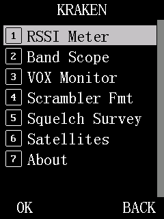

# Kraken user guide

Kraken is an add-on firmware for the Baofeng DM-32UV. It keeps the stock firmware (`DM32.00.01.048`, `DM32.01.L01.048`
or `DM32.01.01.049`; only `DM32.00.01.048` has been tested on a radio so far)
and everything it does, and adds features found on pricier radios: analog APRS, a band scope, a parrot,
satellite tracking, working VOX and more.

Most new rows sit in the stock menu where you would look for them: APRS features in the APRS menu,
per-channel features in **Channel Set**, radio-wide settings in **Radio Settings**. Tools that don't
fit anywhere else are in a new **KRAKEN** category at the end of the top menu.

- **New here?** Start with [Installing Kraken](install.md).
- **Legal:** some features can transmit in ways your licence may not allow: scrambling, wide
  frequency range, data bursts, automatic beacons and IDs. Each page says when the radio will transmit
  and what the rules are. You are responsible for what you transmit.

## Pages

| Page | Features |
|---|---|
| [Installing Kraken](install.md) | The update file, backup, install, going back to stock |
| [APRS](aprs.md) | Analog APRS beacon, APRS RX stations list, RX Monitor, DMR APRS bearing fix |
| [Meters and receive tools](receive-tools.md) | RSSI Meter, Band Scope, Last Heard, GPS Grid, DMR Link, About |
| [Power, squelch and frequency range](radio-settings.md) | TX Power Trim, Squelch Mode, Squelch Survey, Freq Unlock |
| [Parrot and Burst Voice](parrot-and-burst-voice.md) | DMR parrot (record and replay), Burst Voice |
| [VOX and CW ID](vox-cwid.md) | Working VOX, VOX Monitor, CW station ID |
| [Satellites](satellites.md) | Pass prediction and Doppler tracking for FM satellites |
| [DMR privacy](privacy.md) | 16-bit scrambler, stronger random numbers for stock encryption |

## Where everything is

*Emulator screenshot of **Menu > KRAKEN**.*

Press `OK` (MENU) from standby to open the menu. Rows marked *analog* appear only on an analog channel.
Rows marked *digital* appear only on a digital channel.

| Menu path | Row | What it is | Page |
|---|---|---|---|
| **APRS** *(analog)* | Upload ID | Digipeater path for the analog beacon | [APRS](aprs.md) |
| | Upload Beacon | Send one analog APRS beacon now | [APRS](aprs.md) |
| | Callsign | Your callsign and SSID for APRS | [APRS](aprs.md) |
| | APRS RX | List of analog APRS stations heard | [APRS](aprs.md) |
| | RX Monitor | Decode APRS in the background at standby | [APRS](aprs.md) |
| **Call Log** | Last Heard | Recent DMR stations heard | [Receive tools](receive-tools.md) |
| **GNSS** | GPS Grid | Maidenhead locator from GPS | [Receive tools](receive-tools.md) |
| **Settings > Radio Settings** | TX Power Trim | Finer transmit power steps | [Power, squelch, range](radio-settings.md) |
| | Squelch Mode | Noise-based squelch on analog | [Power, squelch, range](radio-settings.md) |
| | Freq Unlock | Wider receive and transmit range | [Power, squelch, range](radio-settings.md) |
| **Settings > Radio Settings > Other Func** | VOX | Voice-operated transmit (now works) | [VOX and CW ID](vox-cwid.md) |
| | CW ID *(analog)* | Periodic Morse callsign | [VOX and CW ID](vox-cwid.md) |
| **Settings > Channel Set** | DMR Link | Live DMR link quality | [Receive tools](receive-tools.md) |
| | Burst Voice | Send a recorded DMR call as a data burst on analog | [Parrot and Burst Voice](parrot-and-burst-voice.md) |
| | Scrambler On/Off, Key | 16-bit DMR scrambler | [DMR privacy](privacy.md) |
| | Parrot On/Off, Replay Audio, Check, Clear Audio, Status | DMR parrot | [Parrot and Burst Voice](parrot-and-burst-voice.md) |
| **KRAKEN** | RSSI Meter | Signal strength in dBm and S-units | [Receive tools](receive-tools.md) |
| | Band Scope | Signal sweep around the current frequency | [Receive tools](receive-tools.md) |
| | VOX Monitor | Live mic level for setting VOX | [VOX and CW ID](vox-cwid.md) |
| | Scrambler Fmt | Scrambler format for other radios | [DMR privacy](privacy.md) |
| | Squelch Survey | Live noise and signal readings | [Power, squelch, range](radio-settings.md) |
| | Satellites | Pass prediction and tracking | [Satellites](satellites.md) |
| | About | What this image is: Kraken name, base firmware, patch list | [Receive tools](receive-tools.md) |
| *(no menu)* | | Stronger random numbers for stock DMR encryption | [DMR privacy](privacy.md) |
| *(no menu)* | | Correct bearings in stock APRS Info | [APRS](aprs.md) |

## Standby tags

When a Kraken feature is switched on and is working on the current channel, a two-letter tag shows on
the standby screen's bottom line, between `Menu` and `A/B`. **Red** tags are features that can make the
radio transmit on their own. **White** tags (or your menu colour) are receive-side features.

**Status:** checked in the emulator only; not yet tested on a radio.
**Where:** the standby screen's bottom line. No menu row; tags appear by themselves.

| Tag | Colour | Feature | Shown when |
|---|---|---|---|
| `VT` | red | VOX Monitor test mode | Sense, Dry or Live is set on the VOX Monitor screen (it stays set after you leave it) |
| `VX` | red | VOX | VOX SW is ON for this channel |
| `CW` | red | CW ID | CW ID SW is ON and a callsign is set |
| `BN` | red | Analog APRS beacon | the automatic beacon is armed (APRS On, an interval, a callsign) |
| `SA` | red | Satellites | tracking is running |
| `SC` | white | Scrambler | the scrambler is applied (digital channel with a key) |
| `MN` | white | RX Monitor | RX Monitor is On |
| `SQ` | white | Squelch Mode | Normal or Tight is set |
| `PR` | white | Parrot | Parrot is On (it records calls you hear) |

- Tags follow the channel you have selected. A tag for an analog-only feature disappears on a digital
  channel, and the reverse. `VT` and `VX` also disappear while dual watch is on, because VOX doesn't
  run then.
- Only one of `VT` and `VX` shows at a time: the one in charge. The test mode overrides VOX SW.
- Four tags fit. With more features on, you see three and then `+N` for the rest. Red tags come first.
- Tags update when you return to standby, and within about a second when something changes on its own,
  for example when satellite tracking ends.
- Freq Unlock and TX Power Trim have no tag: they do nothing until you tune or press `PTT`.

## How tested is each feature?

Every page has a **Status** line under each feature:

- **works on hardware**: used on a real DM-32UV.
- **menu layout is newer**: the feature itself worked on a radio, but its menu rows have since moved
  and the new layout has only been checked in the emulator.
- **emulator only**: built and checked in an emulator, not yet on a radio.

Reports from real radios are welcome, good or bad.

## Settings and power-off

Some Kraken settings are kept in the radio's settings memory and survive power-off. Others are
deliberately kept in RAM only and reset at power-on, usually because they affect transmitting. Each
page's settings table says which. A CPS write or a factory reset can clear Kraken's saved settings
(callsign, Freq Unlock, Burst Voice and CW ID). Set them again afterwards.

A summary of every feature's status is in [feature-status.md](../feature-status.md). To report what
happened on your radio, open a "Hardware test report" issue on the
[project page](https://github.com/awkaplan/dm32uv-kraken/issues).

## For developers

How each feature works, with the reverse-engineering notes behind it, is in the
[developer docs](../README.md). Building is in [Building Kraken](../building.md).
