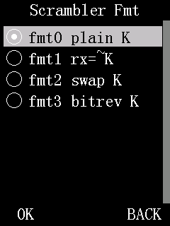

# DMR privacy

Kraken adds a simple voice scrambler for DMR and fixes how the stock firmware picks the random numbers
behind its own DMR encryption.

**Legal note.** On US amateur bands, transmissions encoded to obscure their meaning are not permitted
(47 CFR 97.113(a)(4)). That covers both the scrambler and the stock encryption. Use these features only
on services where the licence allows them (for example a commercial or business licence that permits
privacy), or to experiment without transmitting. Other countries have their own rules.

## Scrambler

A 16-bit voice scrambler built into the radio's DMR chip. With the same key on two Kraken radios, they
hear each other normally. Anyone else hears garbled audio.

**Status:** works on hardware; the menu layout described here is newer and has only been checked in the emulator.
**Where:** **Menu > Settings > Channel Set > Scrambler On/Off** and **Menu > Settings > Channel Set > Key**
(rows shown on any channel; the scrambler only acts on digital channels), plus **Menu > KRAKEN > Scrambler Fmt**.

### Using it

Do these steps on every radio that should hear the others.

1. Set the key: **Menu > Settings > Channel Set > Key**, `OK`. The entry screen is titled `Scrambler Key`.
   It shows the stored key, or `0` if none is set.
2. Type a number from 1 to 65535 with `0`-`9`. `Back` deletes a digit; `Back` on an empty field leaves
   without saving. Press `OK`. The radio shows `Setting is OK`. A value of 0 or above 65535 shows
   `Out of Range` and is not saved.
3. Turn it on: **Menu > Settings > Channel Set > Scrambler On/Off**, `OK`, choose `On` with `Up`/`Down`,
   press `OK`.
4. After `Setting is OK`, the radio shows these warnings, about 1.5 s each:
   - `Set Scrambler` / `Key first` (only if no key is stored; the scrambler stays inactive until you set one)
   - `Weak scrambler,` / `not encrypted`
   - `Not for amateur` / `radio use`
5. Check that every radio uses the same format: **Menu > KRAKEN > Scrambler Fmt**. Leave it at
   `fmt0 plain K` unless you are testing against a different radio (see below).
6. Talk as usual. To stop scrambling, set **Scrambler On/Off** to `Off`, or power the radio off.

The scrambler setting takes effect at once, at every channel change and at the start of each
transmission. It never changes in the middle of a call.

### Scrambler Fmt

*Emulator screenshot.*

The scrambler chip has separate send and receive key slots, and its maker does not document how the key
number should be loaded into them. This row picks one of four ways. It does not change how strong the
scrambler is. It only decides which other radios you can talk to.

| Value | What it does |
|---|---|
| `fmt0 plain K` | Key used as typed, for sending and receiving. The default. |
| `fmt1 rx=~K` | Send as typed; receive with the inverted key. |
| `fmt2 swap K` | Key with its two bytes swapped, both ways. |
| `fmt3 bitrev K` | Key with its bits in reverse order, both ways. |

`fmt0` is the format tested on the air between two Kraken radios. The other three are for experiments
with other radios that use the same scrambler chip. No other make of radio has been tested, so it is not
known which format, if any, matches them. Every radio in a group must use the same key and the same format.

### Settings

| Setting | Values | Default | Kept at power-off? |
|---|---|---|---|
| Scrambler On/Off | `Off`, `On` | `Off` | No. Returns to `Off`. |
| Key | 1-65535 | none | No. Cleared. |
| Scrambler Fmt | `fmt0 plain K`, `fmt1 rx=~K`, `fmt2 swap K`, `fmt3 bitrev K` | `fmt0 plain K` | No. Returns to `fmt0 plain K`. |

All three are lost at power-off on purpose: a scrambler left on silently would make the radio unreadable
to everyone else with no warning after a restart. Set them again after each power-on.

### Limits

- **One setting for the whole radio.** Although the rows are in Channel Set, there is one key, one
  on/off switch and one format for the radio, not one per channel. When on, it applies to every digital
  channel you select.
- **Digital only.** It does nothing on analog channels.
- **Not on channels with stock encryption.** If the channel has a stock privacy key programmed, the
  scrambler stays inactive on that channel and the stock encryption is used instead.
- **Weak.** The key is only 16 bits (65,535 choices) and the voice is mixed with a short repeating pattern
  made from the key. Anyone who wants to break it can, quickly. Treat it as protection from casual
  listeners, not as encryption.
- **Voice only.** Radio IDs, talkgroup and call headers are still sent in the clear, so the call and who
  made it remain visible. Whether DMR text messages and DMR APRS are affected has not been tested.
- **Same chip, same format.** It works only with radios that use the same scrambler chip and the same
  key format. Stock DM-32UV radios and radios from other makers hear garbled audio.

How it works: [../basic-privacy.md](../basic-privacy.md), [../chanset-submenu.md](../chanset-submenu.md), [../stock-option-level.md](../stock-option-level.md)

## Stronger random numbers for stock DMR encryption

Stock DM-32UV encryption (ARC4 or AES, set up in the programming software) uses a message indicator (MI):
a random starting value, sent with the call, that keeps two calls with the same key from using the same
keystream. Kraken makes that value actually random.

**Status:** works on hardware.
**Where:** no menu. Always on.

### What changed

- **Stock firmware:** the MI came from a random-number generator that was never seeded, and only part of
  each number was kept. There were at most 512 different starting values, and the same ones came back
  after every power-on. With AES, a repeated MI under the same key repeats the keystream, which lets a
  listener combine two recorded calls and undo much of the protection.
- **Kraken:** the MI comes from a standard cryptographic random generator (an AES-256 CTR_DRBG). It is
  seeded at power-on from electrical noise the radio measures itself, mixed with values unique to each
  radio, and fresh noise is mixed in before every new MI.

There is nothing to set. If you do not use stock encryption, this does nothing. Other radios decode
your calls exactly as before, because the MI is sent with the call.

### Limits

- It only matters if you use stock encryption, and only where that is legal (see the note at the top).
- On the radio, ten channel loads produced ten different MIs. How much randomness the noise sources really
  give has not been measured.
- It is built in the shape of the NIST CTR_DRBG standard but is not a certified implementation.
- It does not change the stock encryption itself, its key handling, or its compatibility with other radios.
