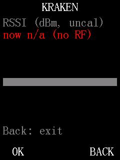
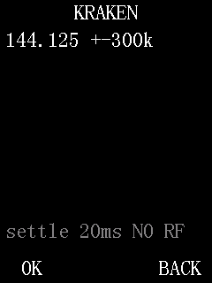
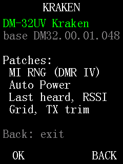

# Meters and receive tools

These screens show what the receiver hears: a signal-strength meter, a band scope, a list of recent
DMR callers, your grid locator from GPS, and DMR link quality. None of them transmit. None of them
have settings that are kept at power-off.

## RSSI Meter

A numeric signal-strength meter for the current channel, in dBm and S-units, with a bar graph. Use it
to compare antennas, find a signal's direction, or check a repeater's input.

**Status:** works on hardware.
**Where:** **Menu > KRAKEN > RSSI Meter** (any channel)

*Emulator screenshot (no radio signal, so readings are empty).*

### Using it
1. From standby press `OK`, select **KRAKEN**, then **RSSI Meter**, and press `OK`.
2. Watch the readings. They update on their own.
3. Press `Back` to leave. The min / max figures start again the next time you open the screen.

### What the screen shows

| Line | Example | Meaning |
|---|---|---|
| Title | `RSSI (dBm, uncal)` | Readings are in dBm, not calibrated (see Limits). |
| `now` | `now -87` | Current level, whole dB, smoothed. Text refreshes about 3 times a second. |
| S-units | `S6` or `S9+12dB` | The `now` value as an S-unit. S9 = -93 dBm, 6 dB per S-unit (the usual VHF/UHF convention). Rounded down to the lower S-unit. |
| `1s` | `1s  -87.5` | Average over the last second, in 0.5 dB steps. |
| min / max | `-121.0 / -64.5` | Lowest and highest level since you opened the screen. |
| Bar | | The smoothed level from -140 dBm (left) to -40 dBm (right). A short mark shows the recent peak; it holds for about 2 seconds (a little longer on digital channels), then follows the level down. |
| `RX avg` | `RX avg -88.0` | The stock firmware's own receive average, shown only while the radio is receiving. Otherwise `RX: idle`. |
| Last line | `Back: exit` | |

If the radio's receiver chip does not answer, the `now` line shows `now n/a (no RF)`.

### How the reading is smoothed
- Each update takes 4 readings. On analog channels it uses their mean.
- On digital channels a DMR signal is only on the air for one timeslot out of two, so a plain average
  jumps by several dB. The meter spreads the 4 readings across one whole DMR frame and uses the
  highest one, which is the level of the active slot. On a steady DMR carrier this holds within about
  1 dB. Updates are a little slower on digital channels.
- The display rises fast (about half a second) and falls slowly (about 1 second), so a fading FM signal
  reads steadily.

### Limits
- Absolute dBm is not calibrated against a signal generator. It uses the receiver chip's published
  formula. Treat it as a relative reading: good for comparing, not for a lab figure. S-units inherit
  the same offset.
- The `RX avg` line comes from the stock firmware. It may not follow the signal during DMR reception.
- The meter reads the selected side of the radio.

## Band Scope

Sweeps 48 frequencies around the current channel and draws the signal level at each one as a bar
graph. Use it to find activity near your frequency or to see how wide a signal is.

**Status:** works on hardware.
**Where:** **Menu > KRAKEN > Band Scope** (analog channels only)

*Emulator screenshot (no radio signal, so readings are empty).*

### Using it
1. Select an analog channel (or analog VFO) in the band you want to look at.
2. Press `OK`, select **KRAKEN**, then **Band Scope**, and press `OK`. The sweep starts at once,
   centred on the channel's receive frequency.
3. Use the keys below to change the view.
4. Press `Back` to leave. The radio goes back to the channel.

While the scope runs, the radio is **not** listening to the channel and the audio is muted. You will
miss calls on the channel until you press `Back`.

| Key | Action |
|---|---|
| `Up` | Wider: next larger step between points |
| `Down` | Narrower: next smaller step |
| `4` | Move the centre down by a quarter of the span |
| `6` | Move the centre up by a quarter of the span |
| `*` | Settle time 10 ms shorter (minimum 20 ms): faster sweep |
| `#` | Settle time 10 ms longer (maximum 60 ms): slower sweep |
| `OK` | Pause / resume. The top line changes colour while paused. |
| `Back` | Leave and return to the channel |

Changing the step or moving the centre clears the graph and starts a new sweep.

### What the screen shows

| Line | Example | Meaning |
|---|---|---|
| Top | `433.050 +-300k` | Centre frequency in MHz, and the distance from the centre to each edge in kHz. |
| Graph | | 48 bars, one per point. Bottom is -130 dBm, top is -50 dBm. The centre bar has a different colour. A short dim mark above a bar is the peak seen at that point; peaks reset every 20 sweeps. |
| Strongest | `433.050 -30dBm` | The strongest point of the last sweep, and its level. |
| Bottom | `settle 20ms` | Current settle time. `NO RF` means the receiver chip did not answer; `nolock N` counts points where the receiver did not lock. |

### Settings

| Setting | Values | Default | Kept at power-off? |
|---|---|---|---|
| Step (span) | 6.25 kHz (+-150k), 12.5 kHz (+-300k), 25 kHz (+-600k), 50 kHz (+-1200k), 100 kHz (+-2400k) | 12.5 kHz | No. Reset each time you open the scope. |
| Settle time | 20 to 60 ms in 10 ms steps | 20 ms | No. Reset each time you open the scope. |

### Limits
- Analog channels only. On a digital channel the screen shows `Analog channel only`.
- Stays inside the band of the current channel: 136-174 MHz or 400-480 MHz. The centre is moved in
  so the whole sweep fits. A channel outside those bands shows `No valid RX freq`.
- A full sweep takes roughly 1.5 to 2 seconds at the default 20 ms settle time. Each extra 10 ms adds
  about half a second. The default was enough for accurate readings on hardware.
- Levels use the same uncalibrated dBm as the RSSI Meter.
- A DMR signal shows as ragged bars, because it is only on the air in one timeslot.
- One receiver: there is no listening while sweeping.

How it works: [../retune-for-scope.md](../retune-for-scope.md)

## Last Heard

A list of the last 16 DMR voice calls the radio received: who talked, to which talkgroup, on which
slot, and how long ago. The stock call log records only private calls to you; this records every voice
call, talkgroups included.

**Status:** works on hardware; the menu layout described here is newer and has only been checked in the emulator.
**Where:** **Menu > Call Log > Last Heard** (the Call Log menu is shown on analog and digital channels)

### Using it
1. Press `OK`, select **Call Log**, then **Last Heard**, and press `OK`.
2. `Up` / `Down` scroll the list. Four calls fit on the screen; the newest is at the top.
3. Press `Back` to return to the Call Log menu.

Calls are recorded in the background whether the screen is open or not. The list updates live.

### What the screen shows
Each call takes two lines.

| Line | Example | Meaning |
|---|---|---|
| First | `N0CALL Sam` | The talker alias, if the caller sends one. Otherwise the contact name from your radio's contact list. Otherwise the caller's DMR ID. Shown in the accent colour while the call is still in progress. |
| Second | `TG91 T1 C1 12s` | Destination: `TG` + talkgroup, `PC` + ID for a private call, or `ALL` for an all-call. Then timeslot (`T1`/`T2`) and colour code (`C`). Then the age. |

The age is the time since the call ended (`s`, `m` or `h`). For a call still in progress it is the
time since the call started. It shows `--` for the first second after you open the screen.

With nothing heard yet, the screen shows `No calls heard yet`.

### Limits
- DMR voice calls only. Analog activity and DMR data are not recorded.
- 16 entries. The oldest drops off when a new call arrives.
- Kept in RAM only: the list is cleared at power-off.
- The timeslot and colour code shown are the channel's settings at the time of the call (a call has to
  match them to be heard), not values decoded from the signal.
- Ages of very old entries can be wrong.

How it works: [../calllog-submenu.md](../calllog-submenu.md), [../last-heard-hooks.md](../last-heard-hooks.md)

## GPS Grid

Shows your Maidenhead grid locator (8 characters) and position from the radio's GPS. Handy for
contests, satellite work and logging.

**Status:** works on hardware; the menu layout described here is newer and has only been checked in the emulator.
**Where:** **Menu > GNSS > GPS Grid** (any channel)

### Using it
1. Turn GPS on with the stock setting **Menu > GNSS > GNSS On/Off**, and wait for a fix (outdoors works
   best).
2. Press `OK`, select **GNSS**, then **GPS Grid**, and press `OK`.
3. Press `Back` to leave.

### What the screen shows

| Line | Example | Meaning |
|---|---|---|
| Title | `GPS / Grid` | |
| `Grid` | `FN00ak06` | Maidenhead locator: field, square, subsquare and extended square (about 0.5 x 0.25 arc-minute). |
| Latitude | `4026.7360 N` | As the GPS sends it: degrees and minutes run together (ddmm.mmmm). |
| Longitude | `07959.8320 W` | As the GPS sends it (dddmm.mmmm). |
| Time | `UTC 18:42:07` | Time of the fix, always UTC. There is no local-time option on this screen. |
| Last line | `Back: exit` | |

The screen updates each time the GPS sends a new valid position.

Without a fix (GPS off, or no valid position yet) the screen shows `No fix` and
`(GPS off, or no RMC with status A)`.

### Limits
- Needs the radio's GPS on and a valid fix. It does not turn GPS on for you.
- If the fix is lost after one was shown, `No fix` comes back but the position and time lines below it
  can still show the last fix.
- The stock firmware sets the radio's clock from GPS on its own. This screen only displays the GPS time;
  it does not change the clock.

## DMR Link

Shows how cleanly the radio is receiving a DMR signal, burst by burst: error counts from the frame's
own check fields and a modulation-quality figure. Use it to compare antennas or locations on a
repeater, or to see why audio breaks up. It is a link-quality figure, not a true bit error rate of
the voice.

**Status:** works on hardware; the menu layout described here is newer and has only been checked in the emulator.
**Where:** **Menu > Settings > Channel Set > DMR Link** (the row shows on any channel; it measures on digital channels only)

### Using it
1. Select a digital channel.
2. Press `OK`, select **Settings > Channel Set > DMR Link**, and press `OK`.
3. Receive a DMR voice call. The figures build up while the call lasts.
4. Press `0` to clear the figures and start again.
5. Press `Back` to leave.

The figures start from zero each time you open the screen. They are a running average: after about
1,000 bursts, older bursts count for less.

### What the screen shows

| Line | Example | Meaning |
|---|---|---|
| Title | `DMR link quality` | |
| Bursts | `voice bursts 150` | Voice bursts counted. Shows `idle, bursts 150` about 1 second after the call ends. `no DMR burst` until a call is heard; `n/a (analog)` on an analog channel. |
| `EMB err` | `EMB err 0% (0)` | Share (and count) of voice bursts whose embedded signalling field failed its error check. |
| `chk err` | `chk err 0% (0)` | Share (and count) of voice bursts that failed a second check on the same field. |
| `EVM` | `EVM 10 last 9` | Modulation error figure from the radio's DMR chip: average, then the last burst. Lower is better. |
| `sync` | `sync 0/48 avg 0.3` | Bit errors in the 48-bit sync pattern of the last sync burst (one per 360 ms superframe), then the average. |
| Slot | `CC 1 TS1 burst C` | Colour code and timeslot of the received burst, and which burst (A-F) of the superframe it was. |
| Note | `Link qual, not BER` | |
| Keys | `1:raw log 0:reset` | |

### What the numbers mean in practice
- A clean signal: `EMB err` and `chk err` at 0%, `sync` at or near 0/48, `EVM` around 9 to 11. That is
  what a strong signal from a nearby radio read on hardware.
- As the signal weakens, `EVM` rises first, then sync bit errors and EMB errors appear. Audio
  breaks up when the error percentages climb.
- The sync figure is the closest thing to a bit error rate: the average divided by 48 is a rough
  error rate for the bits around the sync pattern (for example `avg 2.4` is about 5%). It is a small
  sample: 48 bits per 360 ms.
- `EVM` has no published unit. Use it to compare readings on the same radio, not as an absolute value.
  Weak-signal thresholds have not been measured yet.

### Limits
- Digital channels only. DMR data and control bursts are not counted, only voice bursts.
- It does not measure errors in the voice payload itself; the radio's chip has no counter for that.
- `1` switches to a raw hexadecimal view of the chip's registers, meant for developers. Press `1` again
  to return to the summary.

How it works: [../dmr-ber.md](../dmr-ber.md), [../chanset-submenu.md](../chanset-submenu.md)

## About

**Where:** **Menu > KRAKEN > About** (any channel)

*Emulator screenshot.*

It shows the Kraken name, the stock firmware it is built on (its version, for example `DM32.00.01.048`) and a short
list of
patches. Press `Back` to leave.
